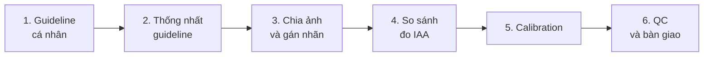

# Day07 — DucTungBao — L2

**Trạng thái: Release — vòng QC 5.** Link bài nộp giữ nguyên; các lỗi ở vòng 2 đã được sửa và kiểm lại. Giữ toàn bộ lịch sử thay vì xóa kết quả Hold.

- Thành viên: 178, 144, 138; đủ 80/80 lượt trên 40 ảnh.
- IAA: 268 cặp, IoU 0,882; cùng lớp 96,6%. Đây không phải accuracy so với ground truth.
- Nhãn cuối: **474 annotations / 40 ảnh**; không còn cờ can_review.
- QC vòng 5: **40/40 ảnh**, 0 lỗi còn ghi nhận sau sửa; kết quả dựa trên xác nhận 31 ảnh của 178 và lượt sửa/kiểm lại của trợ lý theo ủy quyền. Không ghi là review mới của 144.
- [Báo cáo QC](submission/qc/QC_REPORT.md), [phiếu vòng 5](submission/qc/reviews/round-05/qc_review.csv), [nhãn cuối](submission/qc/labels_calibrated.json), [lịch sử sửa](submission/qc/calibration_applied.csv).

```powershell
$env:PYTHONUTF8 = "1"
python scripts/validate_labels.py --all
python scripts/check_submission.py --round 5
python -m unittest discover -s tests -v
```

Release áp dụng cho bài lab, không chứng nhận dữ liệu vận hành thực tế hoặc accuracy theo ground truth.

---

**Nhóm 2–5 người · 4 giờ · 40 ảnh đường phố · gán box bằng CVAT**

Bạn nhận một guideline **sơ sài** và 40 ảnh chứa nhiều tình huống mà nó không nói tới.
Nhóm **viết lại guideline cho đủ dùng**, gán nhãn độc lập, đo độ đồng thuận, họp calibration,
rồi bàn giao nhãn kèm quyết định **Release / Hold / Rework**.


*Tuk-tuk, xe chở xe, tượng, xe giả tưởng, tượng pickup, ma-nơ-canh… Guideline của bạn phải xử lý được chúng.*

## Quy trình



Trọng tâm là **guideline**: nhãn chỉ tốt khi mọi người hiểu quy tắc giống nhau.

## Bắt đầu

1. Clone [repo lab](https://github.com/VinUni-AI20k/K5-L23-Day07-Guideline-Taxonomy-QC). Nộp bài bằng repo riêng tư hoặc gói nén theo hướng dẫn của coach.
2. Cài Python 3.9+ và `python -m pip install -r requirements.txt`. Dùng tài khoản CVAT của lớp.
3. Mỗi người nhận một **mã thành viên** ba chữ số (ví dụ `101`). Đọc **[GUIDE.md](GUIDE.md)** rồi **[RULES.md](RULES.md)**.

## Tài liệu

| Bạn cần | Xem |
|---|---|
| Các pha làm việc và lệnh | [GUIDE.md](GUIDE.md) |
| Mốc tiến độ 4 giờ | [CHECKPOINTS.md](CHECKPOINTS.md) |
| Quy tắc làm bài | [RULES.md](RULES.md) |
| Chấm điểm (100 điểm) | [RUBRIC.md](RUBRIC.md) |
| Gói phải nộp, cách nộp, checklist | [SUBMISSION.md](SUBMISSION.md) |
| Thông tin nhóm, kết quả tóm tắt | [TEAM.md](TEAM.md) |
| Dùng CVAT và COCO | [docs/CVAT_SETUP.md](docs/CVAT_SETUP.md) |
| Công thức, ngưỡng, cây quyết định QC | [docs/QC_CHEATSHEET.md](docs/QC_CHEATSHEET.md) |
| Mẫu báo cáo QC, ghi chú cá nhân | [docs/QC_REPORT_TEMPLATE.md](docs/QC_REPORT_TEMPLATE.md), [docs/INDIVIDUAL_NOTE_TEMPLATE.md](docs/INDIVIDUAL_NOTE_TEMPLATE.md) |
| Các lệnh và file đầu ra | [scripts/README.md](scripts/README.md) |
| Guideline khởi đầu (v0), khung viết guideline | [guideline/](guideline/) |
| Nguồn và giấy phép ảnh | [data/README.md](data/README.md) |
| **Coach:** chuẩn bị lớp, ma trận kiểm thử | [docs/COACH_GUIDE.md](docs/COACH_GUIDE.md), [docs/TEST_MATRIX.md](docs/TEST_MATRIX.md) |
