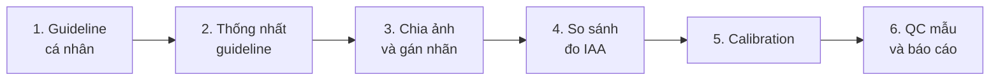

# Day 07 Lab — Nhóm DucTungBao: 2A202603178 - Nguyễn Cao Ngọc Đức, 2A202603144 - Nguyễn Khánh Tùng, 2A202603138 - Hoàng Gia Bảo

## Nhóm và trạng thái setup

- Repo public: https://github.com/ducnguyen-ai/K5-L23-DAY07-DucTungBao-GuidelineQC
- Tên nhóm: **DucTungBao**; tên repo đúng mẫu SUBMISSION: **K5-L23-DAY07-DucTungBao-GuidelineQC**.
- Lớp: **L2**; nhóm **3 người**, mỗi ảnh **K = 2 người gán độc lập**.
- Nguyễn Cao Ngọc Đức: **178**, GitHub [ducnguyen-ai](https://github.com/ducnguyen-ai), email Git `26ai.ducncn@vinuni.edu.vn`.
- Nguyễn Khánh Tùng: **144**, GitHub [sfpcshch](https://github.com/sfpcshch).
- Hoàng Gia Bảo: **138**, GitHub [GBao294](https://github.com/GBao294).
- Mỗi thành viên tự cấu hình Git bằng tên/email của mình. Dùng MSHV đầy đủ trên tiêu đề README; dùng **178/144/138** trong TEAM, assignment và tên file cá nhân.
- Đã chuẩn bị môi trường Python và chia ảnh. **Chưa hoàn thành guideline cá nhân, chưa chốt v1.0, chưa gán nhãn hoặc đo IAA.** Fork và lịch sử đề gốc được giữ nguyên.

## Bắt đầu trên máy mỗi thành viên

```powershell
git clone https://github.com/ducnguyen-ai/K5-L23-DAY07-DucTungBao-GuidelineQC.git
cd K5-L23-DAY07-DucTungBao-GuidelineQC
python -m venv .venv
.venv/Scripts/python.exe -m pip install -r requirements.txt
.venv/Scripts/python.exe scripts/split_assign.py --members 178,144,138 --seed 42 --copy-images
```

| Thành viên | Ảnh được giao | Thư mục upload CVAT | File guideline cá nhân |
|---|---:|---|---|
| 178 - Nguyễn Cao Ngọc Đức | 27 | `work/178/images/` | `guideline_178_NguyenCaoNgocDuc.md` |
| 144 - Nguyễn Khánh Tùng | 27 | `work/144/images/` | `guideline_144_NguyenKhanhTung.md` |
| 138 - Hoàng Gia Bảo | 26 | `work/138/images/` | `guideline_138_HoangGiaBao.md` |

- **Pha 1:** cả ba tự xem đủ 40 ảnh gốc để tìm điểm mơ hồ trong v0, dùng `guideline/TEMPLATE_guideline.md` để tự viết bản cá nhân vào `submission/guidelines/individual/`. Không xem bản của nhau trong pha độc lập.
- Sau khi từng người tự commit bản cá nhân, họp chốt `guideline_v1.0_agreed.md` và `submission/taxonomy.json`, rồi chạy `scripts/make_cvat_labels.py` và tạo task CVAT riêng.
- **Pha 3:** chỉ gán ảnh được giao trong bảng/danh sách `submission/qc/assignments/`; không phải mỗi người gán cả 40 ảnh. Mỗi ảnh vẫn có đúng hai bộ nhãn độc lập.
- Tên task đề xuất: `Day07-DucTungBao-178`, `Day07-DucTungBao-144`, `Day07-DucTungBao-138`.
- Export COCO 1.0 tương ứng: `submission/labels/178_NguyenCaoNgocDuc.json`, `144_NguyenKhanhTung.json`, `138_HoangGiaBao.json`.
- Theo RULES.md, AI được hỗ trợ giải thích/script/chính tả; không gán box hoặc quyết định ca ảnh thay người làm. Không tạo kết quả QC khi chưa thực hiện.

### Tương thích ID rút gọn

`check_submission.py` được điều chỉnh riêng bước kiểm tiêu đề: chấp nhận mã 3 chữ số khi khớp duy nhất đuôi MSHV đầy đủ trên README. TEAM/assignment dùng 178/144/138, README giữ 2A202603178/2A202603144/2A202603138 theo yêu cầu nhóm. Các kiểm tra sản phẩm bắt buộc, script nhãn và toàn bộ ngưỡng QC giữ nguyên. Ghi chú thay đổi này vào báo cáo QC cuối bài.

---

**Nhóm 2–5 người · 4 giờ · 40 ảnh đường phố châu Á · gán box bằng CVAT**

Bạn nhận một guideline gán nhãn **sơ sài** và 40 ảnh chứa nhiều tình huống mà nó không nói tới.
Việc của nhóm: **viết lại guideline cho đủ dùng**, chia việc, gán nhãn độc lập, đo độ đồng thuận, họp calibration,
rồi quyết định **Release / Hold / Rework** cho lô nhãn.


*Có gì lạ trong ảnh? Tuk-tuk, xe chở xe, tượng, xe giả tưởng, tượng pickup, ma-nơ-canh… Guideline của bạn phải xử lý được chúng.*

## Quy trình



Trọng tâm là **guideline**: nhãn chỉ tốt khi mọi người hiểu quy tắc giống nhau.

## Bắt đầu

1. **Fork** repo thành repo **public** của nhóm, mời các bạn làm collaborator, mỗi người `git clone`.
2. Đọc **[GUIDE.md](GUIDE.md)** (từng pha, lệnh chạy) và **[RULES.md](RULES.md)**.
3. `pip install -r requirements.txt` (Python 3.9+).

> Tiêu đề đã điền đủ hai thành viên. Trước khi nộp, đối chiếu [SUBMISSION.md](SUBMISSION.md).

## Tài liệu

| Bạn cần | Xem |
|---|---|
| Các pha làm việc và lệnh | [GUIDE.md](GUIDE.md) |
| Mốc tiến độ 4 giờ | [CHECKPOINTS.md](CHECKPOINTS.md) |
| Quy tắc làm bài | [RULES.md](RULES.md) |
| Chấm điểm (100 điểm) | [RUBRIC.md](RUBRIC.md) |
| Sản phẩm phải nộp, tên repo, checklist | [SUBMISSION.md](SUBMISSION.md) |
| Thông tin nhóm và kết quả tóm tắt | [TEAM.md](TEAM.md) |
| Cài và dùng CVAT | [docs/CVAT_SETUP.md](docs/CVAT_SETUP.md) |
| Công thức, ngưỡng, cây quyết định QC | [docs/QC_CHEATSHEET.md](docs/QC_CHEATSHEET.md) |
| Mẫu báo cáo QC, ghi chú cá nhân | [docs/QC_REPORT_TEMPLATE.md](docs/QC_REPORT_TEMPLATE.md), [docs/INDIVIDUAL_NOTE_TEMPLATE.md](docs/INDIVIDUAL_NOTE_TEMPLATE.md) |
| Các script | [scripts/README.md](scripts/README.md) |
| Guideline khởi đầu (v0), khung viết guideline | [guideline/](guideline/) |
| Nguồn và giấy phép ảnh | [data/README.md](data/README.md), [data/ATTRIBUTION.csv](data/ATTRIBUTION.csv) |
