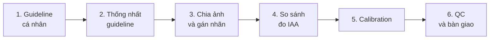

# Day 07 Lab — Nhóm DucTungBao — mã 178, 144, 138

## Setup nhóm sau khi cập nhật đề

- Repo: `K5-L23-DAY07-DucTungBao-GuidelineQC`; lớp **L2**, 3 thành viên, mỗi ảnh **K = 2 người gán độc lập**.
- Đã cài môi trường và có assignment. Chưa có guideline cá nhân, v1.0 đã khóa, nhãn, IAA hoặc kết quả QC.
- Bản đề mới chỉ dùng mã trong tên file, Task và nhật ký. Không đưa họ tên, MSHV đầy đủ hay email vào artifact nộp; bảng đối chiếu gửi riêng qua kênh lớp.
- Fork này vẫn public. Gửi guideline/nhãn cá nhân riêng cho đến khi cả nhóm hoàn thành pha độc lập; không push sớm lên repo chung. Nộp cuối qua repo private có quyền coach hoặc ZIP qua LMS theo [SUBMISSION.md](SUBMISSION.md).
- Lịch sử fork có thông tin thành viên từ setup trước; việc sửa nội dung hiện tại không xóa lịch sử đó. Không dùng link fork public thay cho kênh nộp riêng tư mới.

## Guideline tổng hợp đang chờ nhóm xác nhận

[Bản chung v1.0-proposed](submission/guidelines/guideline_v1.0_proposed.md) đối chiếu ba nguồn 138/144/178, có bảng sửa mâu thuẫn và các mục cần chốt. [Taxonomy đề xuất](submission/guidelines/taxonomy_v1.0_proposed.json) gồm 7 lớp đối tượng và ignore_region, chưa thay taxonomy active. Nguồn 178 là nháp có AI hỗ trợ, chưa có xác nhận đã review; nguồn 144 lấy từ branch cá nhân, không nhập nhãn của branch đó vào main. Chưa tạo bản agreed hoặc tuyên bố nhóm đã khóa v1.0.

## Cài và tái lập phân công

```powershell
python -m venv .venv
.venv/Scripts/python.exe -m pip install -r requirements.txt
.venv/Scripts/python.exe scripts/split_assign.py --members 178,144,138 --seed 42 --copy-images
```

| Mã | Số ảnh gán | Thư mục ảnh | Guideline cá nhân | Nhãn COCO 1.0 |
|---|---:|---|---|---|
| 178 | 27 | `work/178/images/` | `guideline_178.md` | `178.json` |
| 144 | 27 | `work/144/images/` | `guideline_144.md` | `144.json` |
| 138 | 26 | `work/138/images/` | `guideline_138.md` | `138.json` |

- Pha 1: mỗi người xem đủ 40 ảnh gốc, tự viết guideline theo `guideline/TEMPLATE_guideline.md`, gửi riêng. Sau khi tất cả nộp, mới mở bản của nhau để họp.
- Pha 2: nhóm khóa `guideline_v1.0_agreed.md` và taxonomy v1.0; giữ nguyên mục `rules`; chạy `scripts/make_cvat_labels.py` trước tạo task.
- Pha 3: chỉ upload ảnh được giao theo `submission/qc/assignments/<mã>.txt`; task tên `Day07-178`, `Day07-144`, `Day07-138`. Gán độc lập, export và gửi riêng trước khi tổng hợp.
- File guideline đặt ở `submission/guidelines/individual/`; nhãn ở `submission/labels/`; ghi chú cá nhân ở `submission/individual_notes/178.md`, `144.md`, `138.md`.
- Các bước calibration, manifest và QC theo vòng dùng nguyên script mới; chưa tạo artifact đánh giá khi chưa review thật.

## Kiểm tra môi trường / script

```powershell
$env:PYTHONUTF8 = "1"
.venv/Scripts/python.exe -m unittest discover -s tests -v
```

Bộ test dùng dữ liệu tạm, không phải nhãn thực tế của nhóm. `check_submission.py --round 1` chỉ kiểm bài hoàn chỉnh khi có đầy đủ đầu vào; setup xong chưa đồng nghĩa bài đã hoàn thành.

---

**Nhóm 2–5 người · 4 giờ · 40 ảnh đường phố · gán box bằng CVAT**

Bạn nhận một guideline **sơ sài** và 40 ảnh chứa nhiều tình huống mà nó không nói tới.
Nhóm **viết lại guideline cho đủ dùng**, gán nhãn độc lập, đo độ đồng thuận, họp calibration,
rồi bàn giao nhãn kèm quyết định **Release / Hold / Rework**.


*Tuk-tuk, xe chở xe, tượng, xe giả tưởng, tượng pickup, ma-nơ-canh… Guideline của bạn phải xử lý được chúng.*

## Quy trình



Trọng tâm là **guideline**: nhãn chỉ tốt khi mọi người hiểu quy tắc giống nhau.

## Bắt đầu

1. Clone [repo lab](https://github.com/VinUni-AI20k/K5-L23-Day07-Guideline-Taxonomy-QC). Nộp bài bằng repo riêng tư hoặc gói nén theo hướng dẫn của coach.
2. Cài Python 3.9+ và `python -m pip install -r requirements.txt`. Dùng tài khoản CVAT của lớp.
3. Mỗi người nhận một **mã thành viên** ba chữ số (ví dụ `101`). Đọc **[GUIDE.md](GUIDE.md)** rồi **[RULES.md](RULES.md)**.

## Tài liệu

| Bạn cần | Xem |
|---|---|
| Các pha làm việc và lệnh | [GUIDE.md](GUIDE.md) |
| Mốc tiến độ 4 giờ | [CHECKPOINTS.md](CHECKPOINTS.md) |
| Quy tắc làm bài | [RULES.md](RULES.md) |
| Chấm điểm (100 điểm) | [RUBRIC.md](RUBRIC.md) |
| Gói phải nộp, cách nộp, checklist | [SUBMISSION.md](SUBMISSION.md) |
| Thông tin nhóm, kết quả tóm tắt | [TEAM.md](TEAM.md) |
| Dùng CVAT và COCO | [docs/CVAT_SETUP.md](docs/CVAT_SETUP.md) |
| Công thức, ngưỡng, cây quyết định QC | [docs/QC_CHEATSHEET.md](docs/QC_CHEATSHEET.md) |
| Mẫu báo cáo QC, ghi chú cá nhân | [docs/QC_REPORT_TEMPLATE.md](docs/QC_REPORT_TEMPLATE.md), [docs/INDIVIDUAL_NOTE_TEMPLATE.md](docs/INDIVIDUAL_NOTE_TEMPLATE.md) |
| Các lệnh và file đầu ra | [scripts/README.md](scripts/README.md) |
| Guideline khởi đầu (v0), khung viết guideline | [guideline/](guideline/) |
| Nguồn và giấy phép ảnh | [data/README.md](data/README.md) |
| **Coach:** chuẩn bị lớp, ma trận kiểm thử | [docs/COACH_GUIDE.md](docs/COACH_GUIDE.md), [docs/TEST_MATRIX.md](docs/TEST_MATRIX.md) |
